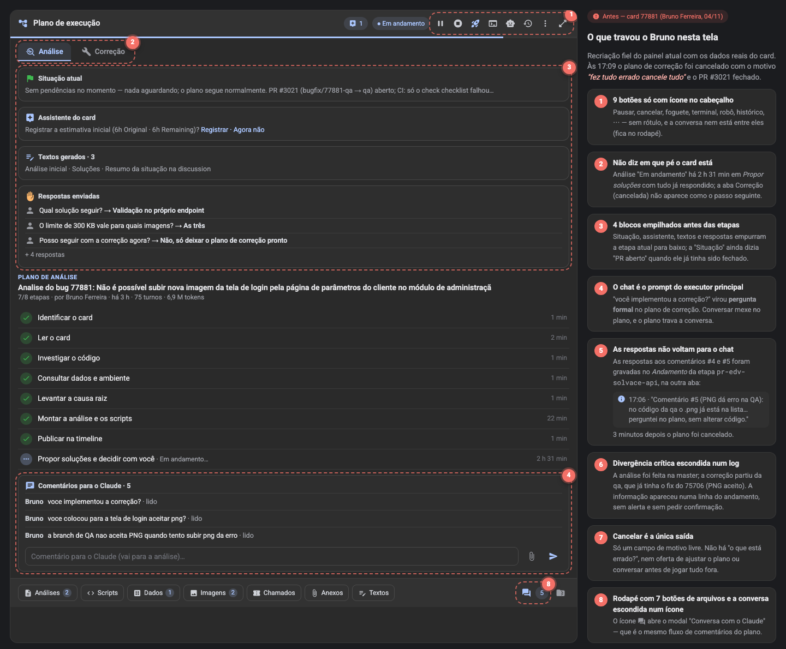
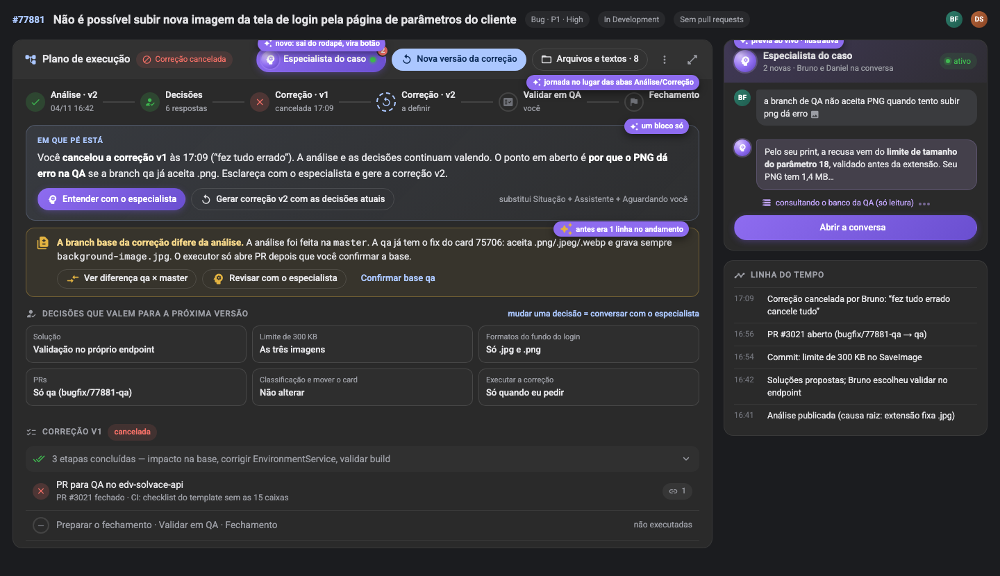
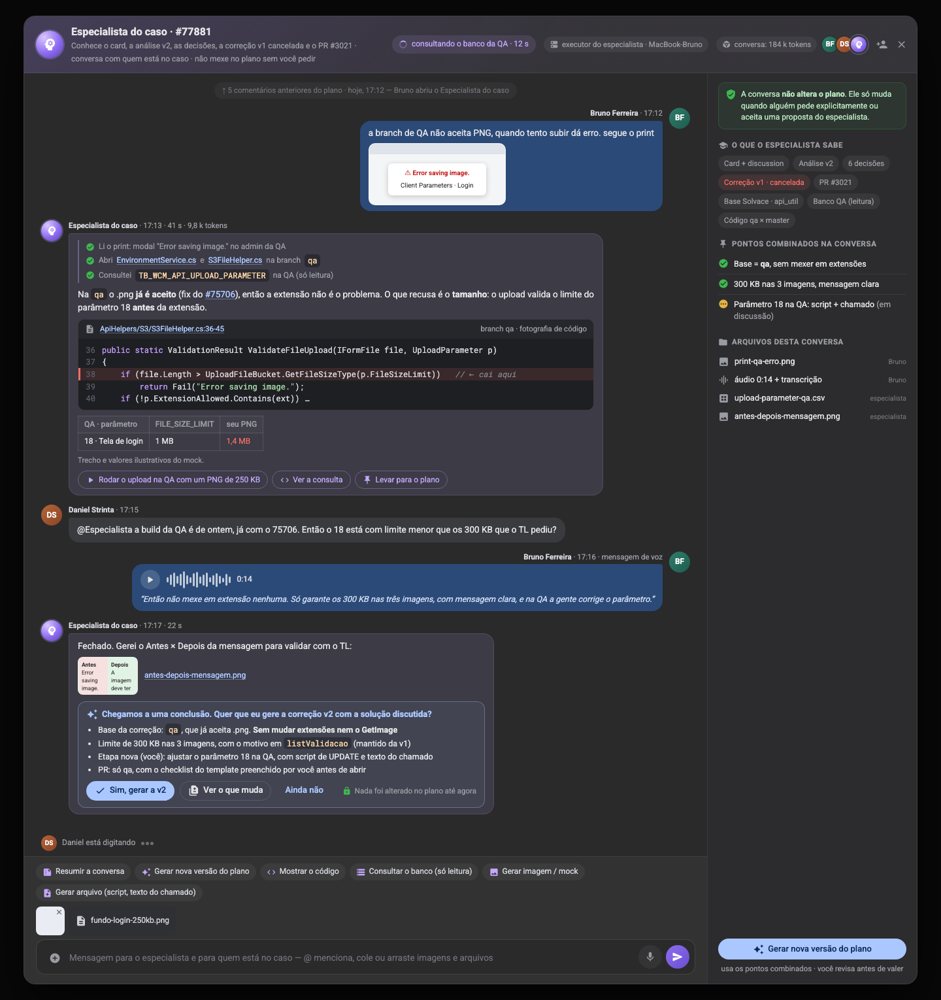
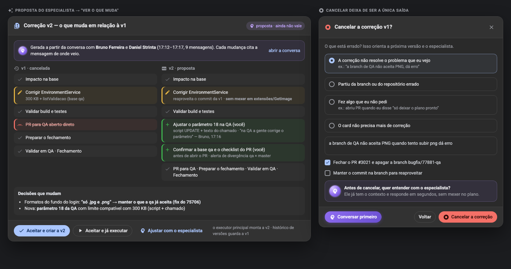
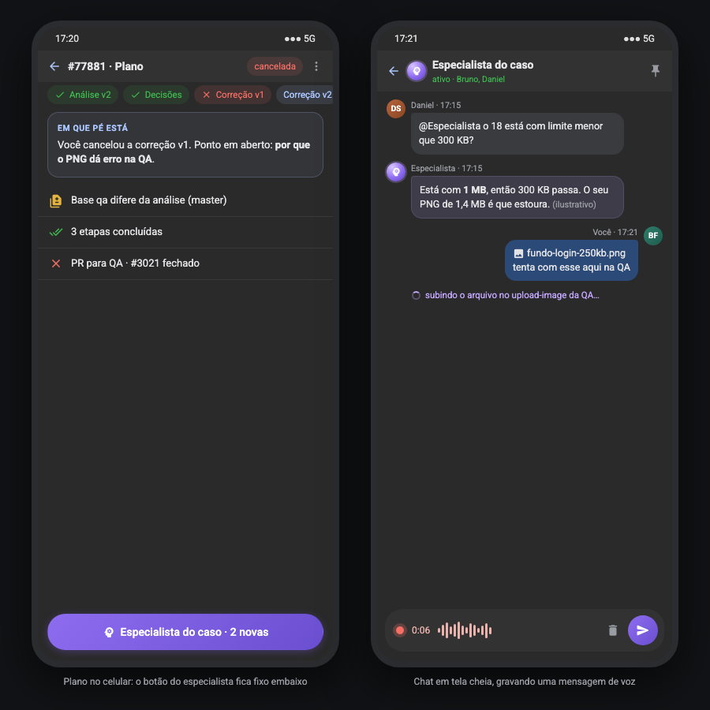

# 0080 — Especialista do caso e tela do plano mais amigável

## Pedido (do usuário, 2026-11-04)
- Estamos em fase de melhorias de usabilidade no tratamento dos cards. Analisar o tratamento que outro usuário fez no
  **card 77881**: ele cancelou a correção e fez perguntas no chat. A tela do plano de análise e execução pode ser mais
  amigável. Analisar a tela inteira, propor melhorias e mostrar com imagens como ficaria.
- O chat vira o **Especialista do caso**:
  - tem um **agente e um contexto separados**. É especialista naquele caso e troca mensagens rápidas com o usuário;
  - a conversa **não altera o plano**. O plano só muda quando o usuário decide explicitamente, ou quando o especialista
    sugere e o usuário aceita;
  - roda num **executor separado** do executor principal do tratamento. Pode gerar imagens, ler e gerar arquivos, ler o
    banco de dados e acessar tudo o que o PRMake já acessa;
  - quando a conversa chega a uma conclusão, ele **pergunta se deve gerar uma nova versão do plano** com a solução
    discutida;
  - tem todos os recursos dinâmicos do PRMake: trechos de código, hiperlinks e ações pedidas pelo usuário (sem mexer no
    plano, salvo decisão explícita);
  - aceita **imagens (enviar e colar), arquivos e mensagens de voz**, e interpreta tudo isso;
  - sai do rodapé e vira um **botão no topo, "Especialista do caso"**, que abre o modal que já existe hoje;
  - a tela é dinâmica: mostra **o que o especialista está fazendo**, tem cara de chat e mostra os **avatares** do usuário
    e do especialista;
  - **outro usuário também pode mandar mensagem** na mesma conversa.

## O que aconteceu no card 77881 (Bruno Ferreira, 04/11)
Dados lidos do PRMake (plano de análise `1f25aa32…`, de correção `1b1b62ee…`, logs, perguntas e comentários):

| Hora | O que aconteceu |
|---|---|
| 16:14 | Comentário #2 (orientação do TL): aceitar PNG, limite de 300 KB e mensagem clara no `upload-image` |
| 16:19–16:41 | Análise feita na **master**. Causa raiz: extensão do fundo fixa em `.jpg`. A etapa ficou 22 min presa porque a skill estava desatualizada (portão da 0075) |
| 16:46–16:47 | Bruno responde 6 perguntas. Q7, "Posso seguir com a correção agora?": **"Não, só deixar o plano de correção pronto"** |
| 16:50 | Comentário #3: *"você implementou a correção?"*. O executor transforma o comentário numa **pergunta formal** no plano de correção ("Posso seguir agora?"), e Bruno responde "Sim" |
| 16:54 | A correção parte da **`qa`**, que já tinha o fix do 75706 (PNG aceito). A divergência em relação à análise aparece **só como uma linha de log** |
| 16:56 | PR #3021 aberto. O CI falha no check `checklist` do template |
| 16:56–16:57 | Comentário #4: *"você colocou para a tela de login aceitar png?"*. A resposta vai para o **Andamento da etapa** `pr-edv-solvace-api`, e não para a conversa |
| 17:04–17:06 | Comentário #5: *"a branch de QA não aceita PNG quando tento subir png dá erro"*. A resposta (hipótese: limite de tamanho do parâmetro 18) vai de novo para o log da etapa, mais uma pergunta formal aberta |
| 17:09 | Bruno cancela a correção: **"fez tudo errado cancele tudo"**. O PR é fechado. A análise continua "Em andamento" em *Propor soluções* |

Leitura: o código não estava tão errado (o limite de 300 KB e a mensagem estavam certos, e a `qa` já aceitava PNG). O
que falhou foi a **comunicação**: o chat e o plano são o mesmo canal; as respostas foram parar em lugares onde o Bruno não
olhava; a divergência master × qa não chamou atenção; e cancelar era a única saída visível.

### Problemas da tela atual
1. **9 botões só com ícone no cabeçalho** (pausar, cancelar, foguete, terminal, robô, histórico, ⋯, tela cheia). A
   conversa nem está entre eles: é um ícone no rodapé.
2. **A tela não diz em que pé o card está.** As abas Análise/Correção são pares soltos: a análise mostra "Em andamento" há
   2 h 31 min com tudo respondido, e a correção cancelada não aparece como o passo seguinte.
3. **Quatro blocos empilhados antes das etapas** (Situação, Assistente, Textos gerados, Respostas). A etapa atual fica
   abaixo da dobra. A Situação ainda dizia "PR aberto" depois que o PR já tinha sido fechado.
4. **O chat é o prompt do executor principal.** Conversar mexe no plano (pergunta formal nova) e o plano trava a conversa
   (o executor só lê na próxima checagem).
5. **As respostas não voltam para o chat.** Ficam no Andamento da etapa, em outra aba.
6. **Divergência crítica escondida num log** (análise na master × correção na qa), sem alerta e sem confirmação.
7. **Cancelar é a única saída.** O motivo é um texto livre; a tela não pergunta o que está errado e não oferece
   ajustar ou conversar antes.
8. **Rodapé com 7 botões de arquivos** e a conversa escondida num ícone.

## Como fica

### A. Tela do plano (M1–M7)

- **M1 — Cabeçalho com rótulos.** A ordem é: **Especialista do caso** (avatar, ponto "ativo", contador de mensagens
  novas), a **ação principal do momento** (uma só, que muda conforme o estado: *Executar a correção*, *Nova versão da
  correção*, *Continuar*, *Pausar*), **Arquivos e textos · N** e "⋯" (terminal, continuar sozinho, histórico de
  versões, baixar .zip, cancelar).
- **M2 — Jornada no lugar das abas.** Análise → Decisões → Correção (vN) → Validar em QA → Fechamento, cada passo com
  status, versão e hora. Uma versão cancelada continua visível (v1 ✕) e a próxima aparece tracejada (v2, a definir).
  Clicar num passo mostra as etapas dele. A análise deixa de ficar "Em andamento" depois que todas as decisões foram
  tomadas: passa a "Decidida".
- **M3 — "Em que pé está": um bloco só.** Junta Situação + Assistente + Aguardando você numa frase e no próximo passo,
  com no máximo 2 botões. Estados que precisam ficar claros:
  - **"Plano de correção pronto: nada foi alterado no código. [Executar a correção]"**. No 77881, foi a falta disso que
    levou à pergunta "você implementou?";
  - "Aguardando você: N perguntas" (as perguntas continuam ali, com as opções);
  - "Correção cancelada por X: motivo. Ponto em aberto: …".
  
  A situação passa a ser recalculada quando o PR fecha e quando o plano é cancelado (no 77881 ficou desatualizada).
  As sugestões do Assistente (0078) viram uma linha dentro desse bloco, sem caixa própria.
- **M4 — Decisões como cartões.** As respostas das perguntas viram "Decisões que valem para a próxima versão"
  (Solução, Limite, Formatos, PRs, Classificação, Executar). Para mudar uma decisão, o usuário conversa com o especialista
  (a decisão não é editada solta).
- **M5 — Divergência vira alerta com confirmação.** Quando a skill percebe que a base real difere do que a análise
  assumiu (branch, repositório, código que já mudou), ela grava um registro do tipo novo `divergence`. A tela mostra um
  alerta amarelo com "Ver diferença", "Revisar com o especialista" e "Confirmar". O executor **não abre PR** enquanto a
  divergência não é confirmada (portão como o `CodeRefGateSteps`).
- **M6 — Etapas focadas.** Etapas concluídas ficam agrupadas ("3 etapas concluídas", expansível). A etapa atual e as
  próximas aparecem primeiro. Os comentários saem do painel do plano (vão para o especialista).
- **M7 — Rodapé enxuto.** Os 7 botões de grupos de arquivos + Textos viram **Arquivos e textos · N** no cabeçalho (o
  diálogo de arquivos ganha abas pelos mesmos grupos). O .zip vai para o "⋯".

Na coluna da direita, acima da Linha do tempo, aparece uma **prévia ao vivo do especialista**: as últimas 2 mensagens, o
que ele está fazendo agora e o botão "Abrir a conversa".

### B. Especialista do caso

**O que ele é**
- Uma conversa **por card** (não por plano: atravessa análise, correção e versões) com um agente próprio: sessão do
  Claude separada da sessão do tratamento, contexto montado para o caso e executor separado.
- Ele **sabe do caso** sem reler tudo: card e discussion, análise vigente, decisões, versões do plano (incluindo as
  canceladas e o motivo), PRs e CI, fotografias de código (0075), Base Solvace, evidências e anexos. Os chips "O que o
  especialista sabe" mostram essa lista.
- Ele **não altera o plano**. Um selo fixo no modal deixa isso claro, e o servidor garante (veja *Regras*).

**Cara de chat**
- Bolhas com **avatar** (foto do usuário pelo Cime.Auth, como na 0051, e avatar próprio do especialista), nome, hora,
  tempo de resposta e tokens. As mensagens do próprio usuário ficam à direita.
- **Vários participantes**: qualquer pessoa com acesso ao card escreve, e os avatares de quem está no caso aparecem no
  cabeçalho, com "convidar" (menção que notifica). O chat mostra "Daniel está digitando…".
- **Ao vivo**: enquanto trabalha, o especialista mostra a atividade atual no cabeçalho ("consultando o banco da QA ·
  12 s") e, na própria bolha, os passos que já fez ("Li o print", "Abri S3FileHelper.cs na qa", "Consultei
  TB_WCM_API_UPLOAD_PARAMETER"). O texto chega em streaming. São os rótulos da 0050, sem mostrar o comando.
- Mensagens ricas, com o mesmo markdown do plano: **trechos de código** com fotografia (`ref:`), linha destacada e
  popover; **hiperlinks** para arquivo:linha, cards (#75706), PRs, itens da Base (UC/RN) e arquivos; tabelas; imagens
  geradas; arquivos gerados para baixar; e **botões de ação sugerida** na bolha ("Rodar o upload na QA com um PNG de
  250 KB", "Ver a consulta", "Levar para o plano").

**O que ele faz**
- Lê arquivos e imagens enviados; **gera imagens** (mock Antes × Depois com o `mock-shot.sh`, prints) e **arquivos**
  (script SQL, texto de chamado, CSV de consulta). Tudo fica em "Arquivos desta conversa", e nada entra no plano
  sozinho.
- **Lê o banco** pelos caminhos somente leitura que as skills já usam (`sql-query.sh`, Cognito, Knowledge Center) e
  **lê código** em qualquer branch (cópia da master, worktree só leitura da `qa`, diff entre branches).
- **Ações pedidas pelo usuário** que têm efeito fora da conversa (subir um arquivo na QA, publicar no DevOps, abrir um
  chamado) aparecem como **cartão de confirmação** na conversa e só rodam depois do "Confirmar". As gravações passam
  pelos endpoints do PRMake, como hoje. O especialista **nunca** faz merge.
- **Pontos combinados**: o especialista (ou o usuário, com "Levar para o plano") fixa as conclusões da conversa na
  lateral ("Base = qa, sem mexer em extensões ✓", "Parâmetro 18 na QA — em discussão").

**Entrada**
- Texto com **@menção** (@Especialista, @pessoa). Colar imagem em qualquer lugar do modal, arrastar arquivos (limites
  atuais: 10 MB por arquivo, 20 por mensagem).
- **Mensagem de voz**: gravar (até 2 min), ouvir antes de enviar, descartar. A **transcrição** aparece na bolha e é a
  parte que o especialista lê; o áudio fica guardado.
- Atalhos: Resumir a conversa · Gerar nova versão do plano · Mostrar o código · Consultar o banco (só leitura) · Gerar
  imagem/mock · Gerar arquivo.

**Do chat para o plano: só com decisão explícita**
- Quando percebe uma conclusão, ou quando alguém pede, o especialista posta um **cartão de proposta**: "Chegamos a uma
  conclusão. Quer que eu gere a correção v2 com a solução discutida?", com a lista do que muda e os botões **Sim, gerar a
  v2 · Ver o que muda · Ainda não**, mais o selo "Nada foi alterado no plano até agora".
- "Ver o que muda" mostra o **diff da versão** (etapas adicionadas, removidas e alteradas, e decisões que mudam), e
  cada mudança cita a mensagem de onde veio.

- **Aceitar e criar a v2** faz o executor principal montar a nova versão (histórico de versões da 0074; a v1 fica no
  histórico). **Aceitar e já executar** monta e roda. **Ajustar com o especialista** volta para a conversa.
- O usuário também pode pedir em texto livre ("pode gerar a v2", "leva isso pro plano"). Nesse caso o especialista
  responde com o cartão de proposta, e o plano muda só depois do clique de alguém com permissão no card.

### C. Cancelar guiado (M8)
- "Cancelar a correção?" pergunta **o que está errado**, com opções (não resolve o problema que eu vejo · partiu da
  branch/repositório errado · fez algo que eu não pedi · o card não precisa mais de correção) mais um texto livre. Também
  pergunta o que fazer com o PR e a branch (fechar e apagar · manter o commit para reaproveitar).
- O diálogo oferece **"Conversar primeiro"** com o especialista. O motivo estruturado vai para a Timeline e entra no
  contexto do especialista e da próxima versão.

### D. Celular (M9)

- No plano, a jornada vira chips roláveis, o bloco "Em que pé está" fica no topo e o botão **Especialista do caso**
  fica fixo embaixo. O chat abre em tela cheia, com gravação de voz no compositor.

## Regras
1. **A conversa nunca altera o plano.** O servidor recusa (403) chamadas de escrita no plano (`steps`, `advance`,
   `block`, `ask`, `answer`, `correction`, `file`, `plan_status`, `devops`, `link`…) feitas pela sessão do especialista
   (`X-Execution-Client: specialist`). A única porta é `POST CaseChat/{card}/proposals/{id}/accept`, chamada por uma
   pessoa, que entrega a proposta ao executor principal.
2. **Comentários deixam de ser prompts do executor principal.** O que o executor principal recebe da conversa é só o
   que alguém leva explicitamente ("Levar para o plano" ou proposta aceita). Esses itens viram uma **instrução do plano**
   (comentário com `toPlan=true`), e a skill lê só esses.
3. **Perguntas do plano continuam no plano** ("Em que pé está" / Aguardando você). O especialista pode ajudar a
   responder ("Perguntar ao especialista" ao lado de cada pergunta), mas quem responde é a pessoa.
4. **Executor separado.** Pedido novo na fila da 0039 (`kind = specialist`), com vaga própria por máquina, que não
   espera o tratamento terminar e não é bloqueado por ele (`busy`). Sessão do Claude própria por card, retomada a cada
   mensagem para responder rápido.
5. **Contexto otimizado.** O servidor monta um pacote compacto do caso (`GET CaseChat/{card}/context`: resumo do card,
   situação, decisões, versões do plano e motivos, PRs/CI, refs de código, pontos combinados e as últimas N mensagens).
   O especialista busca o resto sob demanda pelo MCP e nunca carrega seções grandes inteiras (regras da 0070).
6. **Consumo visível**: tokens por mensagem e da conversa (entrada/saída/total, com o detalhe em popover, como na 0055).
   Roda na máquina e na assinatura de quem executa; nada usa a chave de IA do servidor.
7. **Gravações fora da conversa** (DevOps, QA, chamados) só com o cartão de confirmação, sempre pelos endpoints do
   PRMake. Nunca há merge.
8. **Histórico**: os comentários antigos dos planos aparecem no topo da conversa como histórico (somente leitura,
   "↑ 5 comentários anteriores do plano").
9. **Tempo real** pelo relay (0013): mensagens, "digitando", atividade e streaming no grupo `case-chat:{card}`.

## Back / executor / skill (resumo técnico)
- **Domínio** (`Solvace.ExecutionPlans`, schema próprio): `CaseChat` (card, sessão do especialista, máquina, status),
  `CaseMessage` (autor pessoa ou especialista, tipo `text|voice|activity|proposal|action|system`, markdown, anexos,
  transcrição, menções, `replyTo`, tokens, tempo), `CasePoint` (ponto combinado, status) e `CaseProposal` (mudanças,
  mensagens de origem, status `pending|accepted|rejected|applied`, plano gerado).
- **API**: `GET/POST CaseChat/{card}/messages` (com anexos e áudio), `GET CaseChat/{card}/context`,
  `POST …/points`, `POST …/proposals`, `POST …/proposals/{id}/accept|reject`, `POST …/actions/{id}/confirm`,
  `POST …/typing`. Escritas no plano bloqueadas para o cliente `specialist`.
- **Executor (prmake-agent)**: `kind = specialist`, com vaga própria, sessão por card (`--resume`), atividades e texto
  em streaming para `CaseChat` e timeout curto por mensagem. A máquina escolhida é a de quem enviou a mensagem, se
  estiver online; senão, a do dono do plano; senão, o pedido fica na fila com o motivo visível.
- **Skill nova `especialista-do-caso`** (em `skills/` do backend, publicada pelo /Skills): ferramentas MCP de leitura
  que já existem (`prmake_card`, `prmake_plan`, `prmake_answers`, `prmake_base_*`, `prmake_attachment`), as novas
  `prmake_case_reply`, `prmake_case_activity`, `prmake_case_point`, `prmake_case_propose` e `prmake_case_action`,
  os scripts somente leitura (`sql-query.sh`, `master-wt.sh`, `coderef.py`) e o `mock-shot.sh`. A skill **não** tem as
  ferramentas de escrita do plano.
- **Skill `analisar-bug`**: lê só as instruções `toPlan`, grava `divergence` (M5) e não responde a comentários no log
  da etapa.
- **Front**: `case-specialist-button` (cabeçalho), `case-chat-dialog` (substitui `plan-chat-dialog`), compositor (colar,
  arrastar, voz com `MediaRecorder`), bolhas ricas (reaproveitam `planMarkdown` + `appCodeRefHost`), prévia ao vivo na
  coluna da direita, jornada, bloco "Em que pé está", cartões de decisão, alerta de divergência, cancelar guiado e
  celular.

## Decisões (aceitas pelo usuário em 2026-11-04: "pode seguir com as propostas")
1. **Transcrição da voz**: no navegador (Web Speech API, como o ditado da 0072), com o texto editável antes de enviar.
   Sem reconhecimento no navegador (Firefox), o áudio vai sem transcrição e o especialista pede um resumo em texto.
2. **Quando o especialista responde**: sempre quando há uma pessoa só na conversa; com duas ou mais, só quando for
   mencionado (@Especialista) ou quando a mensagem for uma pergunta. O compositor tem "só entre pessoas".
3. **Modelo**: rápido por padrão (`SpecialistModel`, Sonnet), com escalada para `SpecialistDeepModel` (Opus) quando ele
   precisa investigar fundo. Os dois ficam no Skills Configurations.
4. **Quem aceita a proposta**: o responsável pelo card ou pelo plano, admin ou gestor (os outros veem e comentam).
5. **Análise "Decidida"**: a tela mostra a análise como "Decidida" quando `propor-solucoes` não tem pergunta aberta e o
   plano de correção existe. Isso não muda o status no servidor.

## Fases sugeridas (para o plan.md)
- **B1** domínio + migração + API do CaseChat · **B2** guarda de escrita do especialista + tempo real · **B3** proposta →
  nova versão do plano + `divergence` + situação recalculada.
- **E1** executor `kind = specialist` (vaga própria, sessão por card, streaming) · **S1** skill `especialista-do-caso`
  + MCP `prmake_case_*` · **S2** ajustes na `analisar-bug` (`toPlan`, `divergence`).
- **F1** botão + modal de chat (avatares, ao vivo, bolhas ricas) · **F2** compositor (colar, arquivos, voz) · **F3** tela
  do plano (M1–M7) · **F4** cancelar guiado + proposta/diff · **F5** celular.
- **Q1** e2e local (harness da 0075/0077) reproduzindo o roteiro do 77881.

## Mockups
`mockups/*.html` (fonte) e `mockups/*.png` (gerados com `mock-shot.sh`). Os dados do "Antes" são reais. As conversas do
especialista são **ilustrativas** e foram montadas sobre o caso real (valores como "1 MB" e "1,4 MB" são exemplos).
